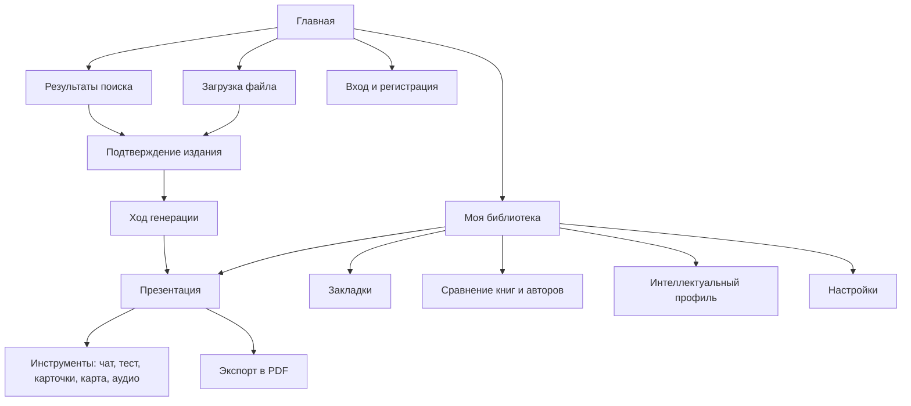

# Этап 2. UX/UI и проектирование интерфейса

## 1. Принципы

1. **Содержание важнее декора.** Интерфейс — рамка для анализа. Любой элемент, который не помогает понять книгу, убирается.
2. **Происхождение всегда видно.** У каждого утверждения есть метка типа и путь к источнику в один клик.
3. **Одна мысль на экран.** Слайд не скроллится на десктопе; длинное содержание делится на несколько слайдов.
4. **Глубина по запросу.** Сначала суть, детали — по клику (Deep Dive, «объясни проще», источник).
5. **Каждая кнопка работает.** Функция, которая ещё не реализована, в интерфейсе не показывается.

## 2. Карта экранов



| Маршрут | Экран | Доступ |
|---|---|---|
| `/` | Главная | все |
| `/search?q=` | Результаты поиска | все |
| `/book/[workId]` | Подтверждение издания и запуск | все |
| `/analysis/[id]` | Презентация | публичные — все, приватные — владелец |
| `/analysis/[id]/print` | Версия для PDF | как у презентации |
| `/library` | Библиотека, закладки, планы | авторизованные |
| `/compare?ids=` | Сравнение книг | авторизованные |
| `/compare/authors?ids=&topic=` | Сравнение авторов по теме | авторизованные |
| `/profile` | Интеллектуальный профиль | авторизованные |
| `/login`, `/settings` | Вход, настройки | — |

## 3. Ключевые сценарии

### 3.1. От названия до презентации

1. **Главная.** Пользователь вводит название и автора в одно поле. Подсказки появляются после паузы в наборе.
2. **Результаты.** Карточки-кандидаты: обложка, название, автор, год первой публикации, число изданий. Если уверенное совпадение одно — сразу шаг 3.
3. **Подтверждение.** «Это та книга?» — обложка, выходные данные, выбор издания и языка анализа. Здесь же блок «У вас есть файл книги? Загрузите для анализа по полному тексту». Кнопка «Создать анализ».
4. **Ход генерации.** Восемь шагов пайплайна со статусами. Слайды открываются по мере готовности — ждать конца не обязательно. Страницу можно закрыть: анализ появится в библиотеке.
5. **Презентация.** См. раздел 4.

Если готовый анализ этой книги уже есть в кэше, шаги 4–5 сливаются: презентация открывается сразу.

### 3.2. Загрузка файла

- Форматы EPUB, PDF, TXT; перетаскивание или выбор файла; лимит размера показан заранее.
- После загрузки — попытка определить книгу по метаданным файла, затем то же подтверждение издания.
- Явное сообщение: «Файл виден только вам и не используется для других пользователей».
- Ошибки: защищённый DRM-файл, скан без текстового слоя, пустой файл — с объяснением, что делать.

### 3.3. Когда источников мало

Перед запуском пользователь видит **отчёт о покрытии**: что найдено (описание, оглавление, рецензии, интервью) и чего нет. Варианты: «Создать обзор по доступным источникам» (слайды, для которых нет данных, будут помечены или пропущены) или «Загрузить файл книги».

## 4. Презентация

### 4.1. Компоновка (десктоп)

```
┌──────────────────────────────────────────────────────────────────┐
│ ← Библиотека   Название книги · Автор        [режим] ☾  ⤓ PDF   │
├────────┬──────────────────────────────────────────┬──────────────┤
│ 01 ●   │                                          │  Инструменты │
│ 02     │                                          │  ─────────── │
│ 03     │              С Л А Й Д                   │  Чат         │
│ 04     │                                          │  Объяснить   │
│ ...    │                                          │  Deep Dive   │
│        │                                          │  Тест        │
│        │                                          │  Карточки    │
│        │                                          │  Карта       │
│        │                                          │  Слушать     │
├────────┴──────────────────────────────────────────┴──────────────┤
│ ◀  3 / 14  ▶          ▬▬▬▬▬▬▬▬▬▬▬▬▬▬▬▬▬▬▬                        │
└──────────────────────────────────────────────────────────────────┘
```

- Слева — навигатор слайдов с названиями разделов, сворачивается.
- Справа — панель инструментов; открытый инструмент работает в контексте текущего слайда.
- Клавиатура: `←` `→` — слайды, `F` — полный экран, `B` — закладка, `/` — чат, `Esc` — закрыть панель.
- Два режима просмотра: **слайды** (по одному) и **чтение** (все разделы одной лентой).

### 4.2. Плашка режима анализа

Постоянный элемент в шапке:

- **«По полному тексту»** — анализ построен на загруженном файле; факты привязаны к главам.
- **«По открытым источникам»** — текст книги недоступен; по клику — список использованных источников и предупреждение о пределах точности.

### 4.3. Метки происхождения

| Тип | Метка | Что означает | По клику |
|---|---|---|---|
| Факт из книги | ● Книга | Утверждение подтверждено текстом или надёжным источником о книге | Глава или источник |
| Интерпретация | ◆ AI | Вывод модели на основе фактов | На каких фактах основано |
| Внешнее исследование | ▲ Исследование | Данные вне книги | Ссылка на публикацию |
| Критический вывод | ■ Критика | Оценка сильных и слабых сторон | Аргументация |

Метка — это форма + подпись + цвет: различение не должно зависеть только от цвета. В настройках можно включить подсветку всех меток или показывать их только при наведении.

### 4.4. Шаблоны слайдов

| Раздел из ТЗ | Шаблон | Особенности |
|---|---|---|
| 1. Обложка | `cover` | Настоящая обложка издания; если её нет — типографическая обложка, без имитации официальной |
| 2. О чём книга | `overview` | Четыре блока: проблема, замысел автора, решение, кому полезно |
| 3. Главные идеи | `ideas` | 5–10 карточек; при числе больше шести — два слайда; у каждой идеи — строка «что с этим делать» |
| 4. Разбор по главам | `chapters` | Вертикальная шкала; по главе на раскрывающуюся карточку; связи между главами |
| 5. Ключевые концепции | `concept` | Один слайд на концепцию со схемой |
| 6. Ценные инсайты | `insight` | Суть, объяснение, пример, «почему это меняет мышление» |
| 7. Применение | `practice` | Шаги с чек-боксами; отмеченное попадает в личный план |
| 8. Мировоззрение автора | `worldview` | Убеждения → модель мышления |
| 9. Критический анализ | `critique` | Колонки: сильное, слабое, спорное, устаревшее |
| 10. Связи | `connections` | Граф связанных теорий и книг |
| 11. Главные выводы | `takeaways` | Одна главная мысль крупно + 10 выводов |
| 12. План внедрения | `plan` | Три колонки: 24 часа, 7 дней, 30 дней |
| AI-аналитика | `scores` | Шесть шкал с объяснением и подписью «оценка AI, не научный рейтинг» |

Типы схем фиксированы: цикл, пирамида, матрица 2×2, поток, сравнение, дерево. Модель выбирает тип и заполняет данные; рисует схему наш компонент. Это даёт единый стиль и исключает «сломанные» картинки.

## 5. Интерактивные инструменты

| Инструмент | Где живёт | Поведение |
|---|---|---|
| AI Book Chat | Правая панель | Ответы с метками происхождения; если ответа в источниках нет — так и говорит |
| Explain Like I'm 5 | Кнопка на любом блоке | Простое объяснение во всплывающей карточке |
| Deep Dive | Кнопка на идее или концепции | Отдельная страница-разбор: контекст, аргументы, возражения, примеры |
| Quiz Mode | Панель или полный экран | 10 вопросов, объяснение после ответа, результат сохраняется |
| Flashcards | Полный экран | Переворот карточки, оценка «знаю / не знаю», интервальное повторение |
| Mind Map | Полный экран | Узлы раскрываются; клик по узлу ведёт на слайд |
| Compare Books | `/compare` | 2–4 книги: таблица по идеям, подходу, оценкам; общий вывод |
| Сравнение авторов | `/compare/authors` | 2–3 автора и тема: позиции по общим вопросам, согласия, расхождения и их причины, что взять у каждого |
| Интеллектуальный профиль | `/profile` | Карта тем, пробелы, другая точка зрения, рекомендации «что дальше» |
| Personal Action Plan | Библиотека | Собирается из отмеченных шагов и ответов на 3 вопроса о целях |
| Listen Mode | Мини-плеер внизу | Озвучка саммари, скорость, переход по разделам |
| Bookmark | Иконка на любом блоке | Закладка с заметкой; все закладки — в библиотеке |

## 6. Главная страница

Сверху вниз:

1. **Заголовок и поле поиска.** Заголовок в одну строку о сути продукта, под ним — крупное поле «Название книги и автор» и кнопка «Создать анализ». Ссылка «или загрузите файл».
2. **Как это работает** — три шага с мини-иллюстрациями.
3. **Примеры готовых презентаций** — 3–4 карточки, открываются без регистрации. На карточке: обложка, название, автор, число идей и время изучения.
4. **Популярные книги** — по числу открытий за неделю.
5. **Моя библиотека** — для вошедших: последние анализы с прогрессом; для гостей — приглашение войти.
6. **Честный блок** «Как мы работаем с источниками» — про метки происхождения и два режима анализа.

## 7. Дизайн-система

### 7.1. Цвет

Нейтральная база и один акцент. **Тёмная тема — основная** и включена по умолчанию; светлая доступна по переключателю и подбирается отдельно, а не инверсией. Тёмный фон — почти чёрный с холодным оттенком, без насыщенного цвета: метки происхождения должны читаться на нейтральной поверхности.

| Токен | Светлая | Тёмная | Назначение |
|---|---|---|---|
| `--bg` | `#FAFAF7` | `#0D0E12` | Фон страницы |
| `--surface` | `#FFFFFF` | `#16181D` | Карточки, слайд |
| `--surface-2` | `#F2F1EC` | `#1E2027` | Вложенные блоки |
| `--border` | `#E4E2DA` | `#2A2D36` | Границы |
| `--text` | `#16161A` | `#F2F2EE` | Основной текст |
| `--text-2` | `#5C5B63` | `#A3A2AB` | Вторичный текст |
| `--accent` | `#3B4EDB` | `#8B9BFF` | Действия, активные состояния |
| `--src-book` | `#1F7A5A` | `#5FD3A6` | Метка «Книга» |
| `--src-ai` | `#6B4BD8` | `#B39DFF` | Метка «AI» |
| `--src-research` | `#9A5208` | `#F2B25C` | Метка «Исследование» |
| `--src-critique` | `#B3344A` | `#FF8FA3` | Метка «Критика» |

Контраст всех текстовых цветов таблицы на всех трёх фонах — не ниже 4.5:1 (посчитано по формуле WCAG для обеих тем).

### 7.2. Типографика

Все шрифты поддерживают кириллицу.

| Роль | Шрифт | Размеры |
|---|---|---|
| Заголовки слайдов | Literata (с засечками, «книжный» характер) | 56 / 40 / 28 |
| Интерфейс и основной текст | Inter | 18 / 16 / 14 |
| Метки, цифры, код | JetBrains Mono | 13 / 12 |

Межстрочный интервал: 1.15 для заголовков, 1.6 для текста. Длина строки — до 70 знаков.

### 7.3. Сетка и отступы

- Шаг 4 px; основные отступы 8, 12, 16, 24, 32, 48, 72, 96.
- Слайд 16:9 с полями 72 px; контент занимает не больше 60 % площади.
- Скругления: 8 (элементы), 16 (карточки), 24 (слайд).
- Тени только в светлой теме и только на одном уровне; в тёмной — граница.

### 7.4. Анимация

- Длительности 150 мс (наведение), 250 мс (панели), 400 мс (смена слайда).
- Смена слайда — сдвиг с затуханием; блоки слайда появляются каскадом с шагом 40 мс.
- При системной настройке «уменьшить движение» остаётся только затухание.

### 7.5. Базовые компоненты

Кнопка, поле ввода, поле поиска с подсказками, карточка книги, метка происхождения, плашка режима, слайд-рамка, навигатор слайдов, панель инструментов, индикатор шагов генерации, всплывающая карточка, диалог, уведомление, заглушка загрузки, пустое состояние, мини-плеер.

## 8. Адаптивность

| Ширина | Поведение |
|---|---|
| ≥ 1280 | Три колонки: навигатор, слайд, инструменты |
| 768–1279 | Навигатор сворачивается в полосу; инструменты — выезжающая панель |
| < 768 | Слайды превращаются в вертикальные карточки со свайпом; инструменты — нижний лист; навигация — нижняя панель |

На телефоне схемы упрощаются (вертикальная раскладка), интеллект-карта открывается как раскрывающееся дерево. Области нажатия — не меньше 44 × 44 px.

## 9. Доступность

- Вся навигация доступна с клавиатуры; видимый фокус.
- Семантическая разметка, подписи для схем и обложек.
- Метки происхождения различаются формой и текстом, а не только цветом.
- Озвучка и текст взаимозаменяемы: всё, что звучит, можно прочитать.

## 10. Состояния

Для каждого экрана проектируются: загрузка (заглушки по форме контента), пусто, ошибка с действием, частичная готовность (часть слайдов ещё генерируется), нет сети, превышен лимит.

## 11. Визуальные референсы

Владелец проекта прислал четыре экрана-ориентира. Берём из них принципы, а не внешний вид один в один.

| Референс | Что берём | Где применяем | Чего избегаем |
|---|---|---|---|
| Панель статистики чтения (тёмная, монохромная) | Крупные числа в карточках, сдержанные графики в оттенках серого, плотная сетка из четырёх колонок | Интеллектуальный профиль; слайд «AI-аналитика» | Мелких подписей, которые не читаются |
| Граф знаний (светящиеся узлы на чёрном) | Связи как главный визуальный образ продукта; свечение активных узлов | Интеллект-карта, слайд «Связь с другими знаниями», карта тем в профиле | Перегруженности: в референсе сотни узлов и подписи нечитаемы |
| Библиотека с обложками (левая панель значков, поиск сверху) | Узкая боковая навигация, поиск в шапке, карточки с обложкой и строкой «число идей · время» | Библиотека, блоки главной | Насыщенного цветного фона |
| Каталог с категориями | Ленты карточек по категориям, фильтры-метки | Блок «Популярные книги», библиотека | — |

Правила для графов, чтобы они оставались читаемыми:

- на одном уровне видно не больше 12 узлов; остальное раскрывается по клику;
- подпись есть у каждого видимого узла и не перекрывается линиями;
- размер узла означает значимость, толщина линии — силу связи; обе шкалы объяснены в подписи к графу;
- на телефоне граф заменяется раскрывающимся деревом.

### Экран интеллектуального профиля

```
┌──────────────────────────────────────────────────────────────────┐
│ Мой профиль                                        за всё время ▾│
├───────────────┬───────────────┬───────────────┬──────────────────┤
│ Книг изучено  │ Идей сохранено│ Тестов пройд. │ Действий выполн. │
│      12       │      86       │      9        │       14         │
├───────────────┴───────────────┴───────────────┴──────────────────┤
│                                                                  │
│                 К А Р Т А   Т Е М  (граф)                        │
│        изученные темы светятся, пробелы — контуром               │
│                                                                  │
├──────────────────────────────────┬───────────────────────────────┤
│ Пробелы и другая точка зрения    │ Что изучать дальше            │
│ · тема — почему это пробел       │ · книга — какой пробел закроет│
└──────────────────────────────────┴───────────────────────────────┘
```

Числа в макете условные. Под картой — пояснение: «изучено» означает, что вы работали с материалом; пробелы — рекомендация AI, а не оценка ваших знаний.

## 12. Критерии готовности этапа

- [x] Карта экранов и маршруты.
- [x] Ключевые сценарии, включая загрузку файла и нехватку источников.
- [x] Шаблоны для всех разделов презентации из ТЗ.
- [x] Дизайн-токены, типографика, правила анимации.
- [x] Правила адаптивности и доступности.
- [ ] Визуальные макеты главной и презентации (делаются в начале этапа 4, до вёрстки).
