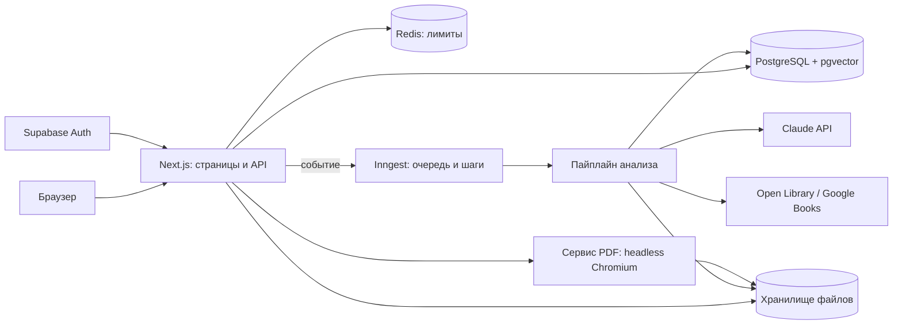
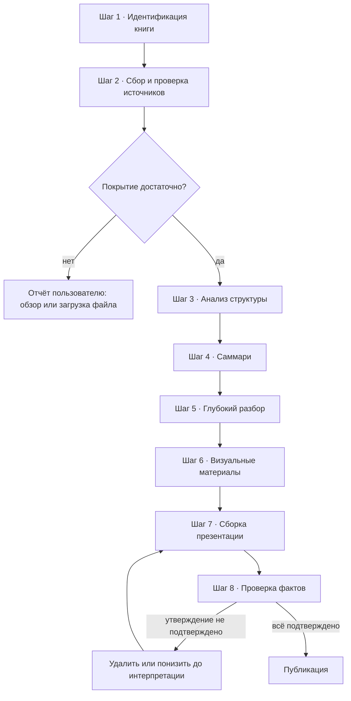
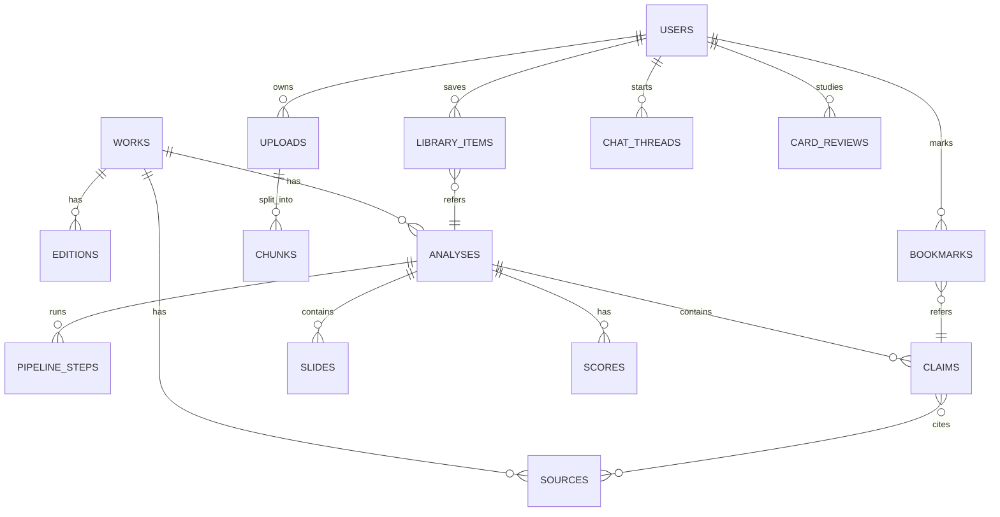

# Этап 3. Архитектура и выбор технологий

Документ описывает полную систему. Какая её часть нужна для первой версии — в документе [«Фокус продукта и MVP»](05-focus-and-mvp.md).

## 1. Главные решения

1. **Единица хранения — утверждение, а не текст слайда.** Пайплайн производит утверждения (claims) с типом и ссылками на источники. Слайды, чат, тест, карточки и интеллект-карта собираются из одного хранилища утверждений. Так требование «разделять факты, интерпретацию, исследования и критику» обеспечивается структурой данных, а не формулировкой промпта.
2. **Слайды — это JSON по схеме, а не сгенерированная вёрстка.** Модель заполняет шаблон, рисует наш компонент. Отсюда единый стиль, надёжный экспорт в PDF и адаптивность.
3. **Пайплайн из восьми отдельных шагов** с сохранением результата каждого. Упавший шаг перезапускается с того же места; изменённый промпт пересчитывает только свой шаг и следующие за ним.
4. **Два режима анализа** — `full_text` и `sources_only` — с разными правилами допустимого. Режим хранится в анализе и показывается пользователю.
5. **Кэш по произведению.** Анализ по открытым источникам общий для всех пользователей; анализ по загруженному файлу — приватный.

## 2. Стек

| Слой | Выбор | Почему |
|---|---|---|
| Frontend + серверная часть | Next.js (App Router) + TypeScript | Один проект для страниц, API и серверного рендера публичных презентаций |
| Стили и анимация | Tailwind CSS, Motion | Токены из [дизайн-системы](02-ux-ui.md) ложатся в конфиг; анимации декларативные |
| Интеллект-карта и графы | React Flow | Готовое масштабирование, перетаскивание, раскрытие узлов |
| База данных | PostgreSQL + pgvector | Реляционные данные и векторный поиск по фрагментам книги в одном месте |
| Авторизация, файлы | Supabase (Auth, Storage, Postgres) | Три сервиса из списка ТЗ закрываются одной платформой; защита на уровне строк |
| Доступ к данным | Drizzle ORM | Типизированные запросы и миграции в репозитории |
| Фоновые задачи | Inngest | Пошаговые функции с повторами и сохранением состояния — прямое соответствие пайплайну |
| AI | Claude API | Веб-поиск со ссылками, структурированные ответы, цитирование документов, кэш промптов (см. [исследование](01-research.md)) |
| Векторные представления | Отдельный провайдер, выбирается на этапе 6 | Нужны для поиска по тексту файла и для профиля; в Claude API своего сервиса для них, насколько известно, нет — проверить при выборе. В MVP не используются: повторы ищет отдельный вызов модели |
| Метаданные книг | Open Library, запасной — Google Books | Без ключа, есть произведения, издания и обложки |
| Разбор файлов | EPUB — распаковка и чтение навигации; PDF — pdf.js; TXT — эвристики заголовков | Работает в фоновой задаче, не в запросе пользователя |
| Экспорт в PDF | Headless Chromium печатает маршрут `/analysis/[id]/print` | PDF совпадает с тем, что на экране |
| Озвучка | Сначала Web Speech API в браузере, затем серверный синтез с кэшем | Нулевая стоимость на старте, качество — позже |
| Кэш и лимиты | Postgres для результатов; Redis (Upstash) для ограничения частоты | Результаты должны переживать перезапуски |
| Хостинг | Vercel | Родная платформа для Next.js |
| Тесты | Vitest (модули), Playwright (сценарии и адаптивность) | Требование ТЗ тестировать каждый этап |

Версии библиотек зафиксированы при инициализации проекта на этапе 4 (`package.json` и `package-lock.json`): Next.js 16.4, React 19.3, Tailwind CSS 4.3, TypeScript 5, Vitest 5, Playwright 1.65. Шрифты Inter, Literata и JetBrains Mono лежат в проекте (пакеты Fontsource) и не загружаются со сторонних серверов.

Модели задаются переменными окружения отдельно для каждого шага: быстрая и дешёвая — для идентификации, теста и карточек; основная — для саммари и сборки; самая сильная — для глубокого разбора и проверки фактов. Конкретные идентификаторы выбираются на этапе 6 по результатам замеров качества и стоимости.

## 3. Общая схема



Пользовательский запрос никогда не ждёт модель дольше, чем длится потоковый ответ чата. Всё тяжёлое — в фоне, интерфейс читает статус шагов из базы.

## 4. AI-пайплайн



| № | Шаг | Вход | Выход | Как проверяется |
|---|---|---|---|---|
| 1 | Идентификация | Строка запроса или метаданные файла | Произведение, издание, уверенность | Подтверждение пользователем |
| 2 | Источники | Произведение | Список источников с типом, датой и надёжностью; отчёт о покрытии | Минимальный набор: описание + два независимых источника о содержании |
| 3 | Структура | Источники или текст | Оглавление с признаком `verified`; для файла — главы и фрагменты | Оглавление берётся из файла или из двух совпадающих источников; иначе `verified = false` |
| 4 | Саммари | Структура и источники | Утверждения типа «факт» по главам или темам; общее саммари | У каждого факта есть ссылка на источник или место в тексте |
| 5 | Разбор | Утверждения шага 4 | Идеи, концепции, инсайты, критика, связи, оценки, план | Проверка на повторы; каждый вывод ссылается на факты |
| 6 | Визуальное | Концепции и идеи | Спецификации схем, граф интеллект-карты | Схема проходит валидацию по типу |
| 7 | Сборка | Всё предыдущее | Слайды в JSON | Валидация по схеме шаблона; лимит текста на слайд |
| 8 | Проверка фактов | Утверждения и источники | Статус каждого факта | Отдельный вызов модели, который не видел генерацию; неподтверждённое не публикуется |

Подробности по шагам:

- **Шаг 1** — в основном обычный код: запрос в Open Library, нормализация имён авторов, ранжирование. Модель подключается только для разбора опечаток и неоднозначных запросов.
- **Шаг 2** в режиме `sources_only` использует веб-поиск модели с ограничением числа запросов; каждый найденный источник сохраняется со ссылкой и выдержкой. В режиме `full_text` главный источник — файл; веб нужен только для критики и внешних исследований.
- **Шаг 4** для полного текста идёт по схеме «сначала каждая глава отдельно, потом книга целиком» — так большие книги укладываются в контекст, а главы обрабатываются параллельно.
- **Шаг 5** — несколько независимых вызовов (идеи, концепции, критика, связи, оценки, план), каждый получает утверждения шага 4, а не сырой текст. Это дешевле и не даёт разделам пересказывать друг друга.
- **Шаг 8** стоит последним, как в ТЗ, и блокирует публикацию. Проверяются утверждения, а не слайды, поэтому исправление не требует полной пересборки.

### Как запреты из ТЗ превращаются в механизмы

| Запрещено | Механизм |
|---|---|
| Выдумывать содержание глав | Слайд «Разбор по главам» строится только при `verified = true`; иначе — «Тематический разбор» с пояснением |
| Приписывать автору несуществующие цитаты | Дословная цитата допускается только при точном совпадении строки с текстом файла или сохранённой выдержкой источника; проверяет код, не модель |
| Выдавать общие рассуждения за анализ книги | У интерпретации обязательны ссылки на факты этой книги; без них утверждение отклоняется |
| Повторять одну мысль ради объёма | Попарное сравнение утверждений (в MVP — вызовом модели, позже — по векторной близости); дубликаты объединяются |
| Давать советы общего вида вместо действий | У действия обязательны объект и срок; без них оно отклоняется |
| Поверхностные саммари | Проверка покрытия: каждая глава или тема из структуры представлена в саммари |
| Выдавать оценки за научный рейтинг | Оценка хранится вместе с объяснением и подписью; без объяснения не сохраняется |
| Большие фрагменты защищённых книг | Лимит длины цитаты и общего числа цитат на анализ; проверка доли дословных совпадений с текстом файла |

Тексты источников и загруженных книг передаются модели как данные: в отдельных блоках, с инструкцией не выполнять содержащиеся в них указания, а вывод ограничен схемой.

## 5. Модель данных



| Таблица | Главное |
|---|---|
| `works` | Произведение: название, авторы, год первой публикации, жанры, внешние идентификаторы |
| `editions` | Издание: ISBN, издатель, год, язык, обложка, оглавление |
| `sources` | Источник: вид (метаданные, оглавление, описание, рецензия, интервью, исследование, текст пользователя), ссылка, дата получения, надёжность, выдержка |
| `uploads` | Файл пользователя: путь, формат, хэш, статус разбора; доступен только владельцу |
| `chunks` | Фрагменты загруженного текста с номером главы и вектором |
| `analyses` | Анализ: произведение, издание, режим, язык, версия пайплайна, статус, владелец (пусто для публичного) |
| `pipeline_steps` | Шаг: статус, хэш входа, результат, модель, число токенов, стоимость, ошибка |
| `claims` | Утверждение: текст, тип (`book_fact`, `ai_interpretation`, `external_research`, `critique`), место в книге, статус проверки, вектор |
| `claim_sources` | Связь утверждения с источником и конкретной выдержкой |
| `slides` | Слайд: порядок, шаблон, блоки со ссылками на утверждения |
| `scores` | Оценка: параметр, значение, объяснение |
| `library_items`, `bookmarks` | Библиотека и закладки пользователя |
| `chat_threads`, `chat_messages` | Чат по книге |
| `quizzes`, `quiz_attempts` | Тесты и результаты |
| `flashcards`, `card_reviews` | Карточки и состояние повторения для каждого пользователя |
| `action_plans` | Личный план внедрения |
| `comparisons` | Сохранённые сравнения книг и авторов: участники, тема, результат |
| `authors` | Автор: имя, варианты написания, внешние идентификаторы, связь с произведениями |
| `topics`, `work_topics`, `claim_topics` | Справочник тем и привязка к ним книг и утверждений |
| `user_topic_stats` | Профиль: по каждой теме — число изученных книг, результаты тестов, повторения, закладки |
| `recommendations` | Рекомендация «что дальше»: книга, какой пробел закрывает, объяснение |
| `actions` | Действие: текст, объект, срок, связь с утверждением, отметка о выполнении |
| `exports`, `audio_assets` | Готовые PDF и аудио |

## 6. Кэширование

| Что | Ключ | Где | Срок |
|---|---|---|---|
| Ответы Open Library | Запрос или идентификатор | Postgres | 30 дней |
| Результат шага пайплайна | Хэш входа + версия промпта + модель | `pipeline_steps` | Пока не изменится версия |
| Публичный анализ | Произведение + язык + версия пайплайна | `analyses` | Бессрочно, с пересборкой при новой версии |
| Deep Dive, объяснения | Утверждение + вид + язык | Postgres | Бессрочно |
| PDF, аудио | Анализ + версия + тема | Хранилище файлов | Пока не изменится анализ |
| Текст книги в запросах к модели | Кэш промптов API | У провайдера | Минуты, в пределах одного прогона |

Два пользователя, одновременно запросившие одну книгу, получают один прогон: второй подписывается на статус первого.

## 7. API

| Метод и путь | Назначение |
|---|---|
| `GET /api/books/search?q=` | Поиск кандидатов |
| `GET /api/books/[workId]` | Произведение, издания, отчёт о покрытии |
| `POST /api/uploads` | Ссылка для прямой загрузки файла в хранилище |
| `POST /api/analyses` | Запуск анализа или возврат готового из кэша |
| `GET /api/analyses/[id]` | Слайды и утверждения |
| `GET /api/analyses/[id]/status` | Статусы шагов |
| `POST /api/analyses/[id]/chat` | Чат, потоковый ответ |
| `POST /api/claims/[id]/explain` | «Объясни проще» |
| `POST /api/claims/[id]/deep-dive` | Углублённый разбор |
| `POST /api/analyses/[id]/quiz` | Создать тест |
| `GET /api/analyses/[id]/flashcards` | Карточки |
| `POST /api/flashcards/[id]/review` | Отметить повторение |
| `POST /api/compare` | Сравнение книг |
| `POST /api/compare/authors` | Сравнение авторов по теме |
| `GET /api/profile` | Интеллектуальный профиль: карта тем, пробелы, рекомендации |
| `POST /api/actions/[id]/done` | Отметить действие выполненным |
| `POST /api/analyses/[id]/plan` | Личный план |
| `POST /api/analyses/[id]/export` | Экспорт в PDF |
| `GET, POST, DELETE /api/library`, `/api/bookmarks` | Библиотека и закладки |

Все ответы и тела запросов описаны общими схемами, из которых выводятся типы для клиента и сервера.

## 8. Безопасность и приватность

- Защита на уровне строк: пользователь видит только свои файлы, приватные анализы, закладки и чаты.
- Файлы загружаются напрямую в хранилище по временной ссылке; проверяются тип по содержимому, размер и число страниц; разбор идёт в изолированной фоновой задаче.
- Ограничение частоты на поиск, запуск анализа и чат; суточный бюджет токенов на пользователя.
- Ключи API хранятся только на сервере.
- Удаление аккаунта удаляет файлы и приватные анализы.

## 9. Масштабирование

- Веб-слой не хранит состояния и масштабируется горизонтально.
- Нагрузка на модель ограничивается параллельностью очереди, а не числом пользователей.
- Самые дорогие операции выполняются один раз на книгу благодаря общему кэшу.
- Точки роста: отдельная реплика для чтения, вынос сервиса PDF, пакетная обработка для фоновой пересборки популярных книг.

## 10. Наблюдаемость и стоимость

- Для каждого шага записываются модель, число токенов, длительность, стоимость и результат проверки.
- Метрики качества: доля утверждений, отклонённых проверкой фактов; доля анализов без подтверждённого оглавления; оценки пользователей.
- Набор из 10–15 контрольных книг разных жанров для регрессионной проверки промптов перед каждым изменением пайплайна.

## 11. Структура репозитория

```
/
├── docs/                 документация по этапам
├── src/
│   ├── app/              страницы и API-маршруты
│   ├── components/       интерфейс: ui/, slides/, tools/
│   ├── pipeline/         восемь шагов, промпты, схемы
│   ├── books/            поиск и идентификация
│   ├── ingest/           разбор EPUB, PDF, TXT
│   ├── db/               схема и миграции
│   └── lib/              общие утилиты, клиент AI, кэш
├── tests/                модульные и сценарные тесты
└── evals/                контрольные книги и проверки качества
```

## 12. Что нужно от владельца проекта

| Что | Для какого этапа |
|---|---|
| Ключ Claude API | 6 |
| Проект Supabase | 5 (загрузка файлов и постоянный кэш поиска; сам поиск стартует с кэшем в памяти), 9 (авторизация) |
| Аккаунты Vercel и Inngest | 6, 10 |
| Контактный адрес для Open Library — необязательно: по умолчанию используется адрес репозитория | 5 |

## 13. Открытые вопросы

1. ~~Установка пакетов в рабочей среде.~~ Решено на этапе 4: пакеты устанавливаются, проект собирается и тестируется на выбранном стеке.
2. **Язык интерфейса.** План исходит из русского по умолчанию с заложенной локализацией; язык анализа выбирается отдельно для каждой книги.
3. **Модель монетизации** не описана в ТЗ; лимиты для бесплатного использования нужно определить до этапа 10.

## 14. Критерии готовности этапа

- [x] Выбран стек с обоснованием по каждому пункту ТЗ.
- [x] Описаны восемь шагов пайплайна с входами, выходами и проверками.
- [x] Каждое требование раздела «Качество контента» привязано к механизму.
- [x] Модель данных, API, кэш, безопасность.
- [x] Стек интерфейса (Next.js, TypeScript, Tailwind CSS, Vitest, Playwright) подтверждён началом этапа 4.
- [ ] Сервисы (Supabase, Inngest, Vercel, Claude API) подтверждаются владельцем проекта при подключении на этапах 5–6.
